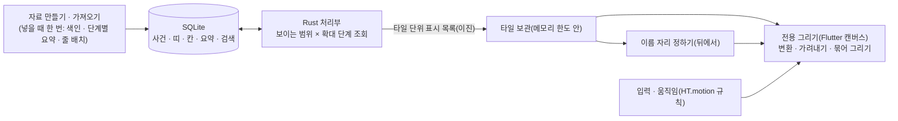

# 아카이브 2단계 설계 — 규모와 병목 검증 (새 연표 엔진의 관문)

작성일: 2026-09-21. 기준 주 작업본: `master` `a39fec9`. 작업 가지: `next-engine`(작업 폴더 `.claude/worktrees/next-engine`).

이 문서는 `docs/계획-대규모-역사-아카이브-2026-09-20.md`(이하 "큰 계획")의 **2단계**를 구체화한 설계다. 큰 계획의 방향·경계·보존 원칙은 그대로 따르고, 여기서는 (1) 2026-09-21에 감독이 다시 밝힌 최종 목표와 그에 따라 높인 합격선, (2) 0·1단계가 남긴 것, (3) 2단계에서 만들 것·잴 것·판정하는 법만 적는다. 현재 상태와 실행 지시의 기준은 여전히 뿌리 `인수인계.md`다.

## 1. 목표와 결정 기록

### 1.1. 감독이 밝힌 최종 목표 (2026-09-21)

> 모든 역사서에 존재하는 모든 역사적 사건·연표를 모조리 넣고, 개인 아카이브처럼 넣다 뺐다 할 수 있는 프로그램. 이 과정에서 움직임에 버벅임이 없어야 하고(있어도 단 한 번), 애플처럼 최적화가 되어 있어야 한다. 모든 걸 갈아엎어야 해도 좋다.

큰 계획 2.1절의 요구와 같은 목표이며, 사용감의 기준만 "거의 버벅임이 없을 것"에서 **"버벅임이 없을 것(허용은 단 한 번 — 자료를 넣는 순간·처음 여는 순간)"**으로 높아졌다. 그래서 큰 계획 11.2절의 예비 목표(60fps 지향 · 느린 5% 20ms)를 이 문서 3절의 합격선으로 바꾼다. 바꾼 이유는 감독의 기준 변경이며, 영향은 "2단계의 통과가 더 어려워지고, 통과하지 못했을 때의 갈림길(7절)을 미리 정해 둔다"는 것이다.

### 1.2. 결정 기록

| 날짜 | 결정 | 근거 |
| --- | --- | --- |
| 2026-09-20 | 방향: Flutter 화면 + Rust 자료 처리부 + SQLite + 전용 GPU 연표. 단계별 이전, 측정으로 판정 | 큰 계획 1절 |
| 2026-09-21 | 감독 "해보자" — 위 방향으로 계속 진행, 다음은 2단계(이 문서) | 웹 연표의 구조적 한계를 실측(2절) |
| 2026-09-21 | 지금의 웹 연표에는 큰 성능 공사를 새로 벌이지 않는다(눈에 안 보이는 절감만). 돋보기 같은 조작·표기 설계는 새 엔진의 설계 기준으로 이어 간다 — 추천안이며 감독의 "해보자"에 포함된 것으로 보고 진행, 달리 정하시면 고친다 | 새 엔진으로 가면 버려질 코드이므로 |
| 2026-09-21 | **일단 컴퓨터(Windows) 전용으로 한다.** Android · S25의 빌드 · 측정 · 터치 손짓은 뒤로 미룬다. 2단계의 판정은 이 PC에서 내리고, 갤럭시북3는 같은 Windows 실행본으로 나중에 재 볼 수 있다(선택). 구현은 새 세션에서 이어 간다 | 감독의 말: "일단 컴퓨터 전용으로만 하자. 새 세션에서 진행할게" |

**범위 메모(컴퓨터 전용)**: 아래 절에 남아 있는 S25 · Android · 터치 · "세 기기" 이야기는 큰 계획과의 연결을 위해 남겨 둔 것이며 2단계에서는 하지 않는다. 자료 처리부와 그리기 코드는 계속 기기와 무관하게 짜되(한 벌의 코드), Android 빌드 · 설치 파일 · 실기기 검증은 이 단계의 산출물도 합격 조건도 아니다.

## 2. 왜 지금 구조로는 닿지 못하는가 — 2026-09-21 실측

월흔해(사건 5,437건) · 1920×1080 · 100% · 실제 휠 입력(빠르게 12칸) · 3회 중앙값. 값은 화면 간격 평균.

| 장면 | 웹 연표(지금) | 비고 |
| --- | ---: | --- |
| 옆으로 끌기 | 14~18ms | 같은 배율이면 준비한 그림을 옮기기만 함(2026-09-20 개선) |
| 전체 → 빠른 확대 · 화면에 트랙 1개 | 43~45ms | |
| 전체 → 빠른 확대 · 화면에 트랙 3개 | 127~130ms | 초당 8장 |
| 좁은 곳 → 빠른 축소 · 트랙 3개 | 76~80ms | |

- 웹 연표는 띠·칸·점·이름 하나하나가 브라우저 요소다. 확대는 매 장면 배율이 바뀌므로 보이는 요소 전부의 자리를 다시 쓰고, 브라우저가 그 전부의 모양·배치·칠하기를 다시 한다. **보이는 트랙 하나당 한 장면에 JS 약 19ms + 모양·배치 9~12ms + 칠하기**가 든다.
- 요령의 한계도 쟀다: 트랙을 나눠 그리고 나머지를 늘려 보여 주기 1.2~1.6배, `:has()` 선택자 걷어 내기 −15~19%, 날짜 칸을 새로 만들지 않기 −5ms, 움직이는 동안 세부(사건·띠 안의 칸)를 그리지 않기 3~4배(43→15ms · 129→31ms). 마지막 것이 가장 크지만 그래도 자료 5천 건에서의 값이고, 여는 시간·메모리는 팩 전체를 읽어 배치하는 구조라 자료와 함께 는다.
- 측정 원본과 도구: `.claude/research/zoom-2/`(주 저장소 뿌리). 돋보기(크기까지 커지는 확대 — 가지 `zoom-2` `efd4642`)의 조작 설계는 새 엔진에서도 그대로 쓴다: 휠 = 기간 확대, Ctrl+휠·집기 = 돋보기, 100%가 아닐 때만 배율 표시.

**새 엔진이 물려받을 교훈**: ① 한 장면의 일은 "보이는 것 × 작은 상수"여야 하고 전체 자료량과 무관해야 한다. ② 글자와 띠 안의 작은 칸이 가장 비싸다 — 글자는 한 번 모양을 잡아 재사용하고, 새 글자는 장면마다 정해진 시간만큼만 준비한다. ③ 움직이는 동안과 멎은 뒤의 세부를 구분하되(큰 계획 8절) 세부를 없애서 성능을 맞추지는 않는다 — 새 엔진에서는 세부를 그린 채로 통과하는 것이 목표이고, "빠르게 움직이는 동안 세부를 옅게"는 통과하지 못했을 때의 마지막 카드다.

## 3. 합격선 (큰 계획 11.2절을 대체)

이 PC(1920×1080 · 100% · 144Hz)에서 잰다 — 컴퓨터 전용 결정. 다른 컴퓨터에서 잴 때는 그 기기의 주사율로 따로 적는다. 한 장면의 예산 T = 1000 ÷ 주사율(144Hz 6.9ms · 120Hz 8.3ms · 60Hz 16.7ms). 아래는 **풍부한 그림(4절)을 켠 채, 100만 사건 자료에서** 시험 구간(옆으로 끌기와 관성 · 빠른 휠 확대와 축소 · 돋보기 · 같은 날 밀집 · 세로 이동 · 자료집 켬/끔) 각각에 적용한다.

| 항목 | 합격선 | 비고 |
| --- | --- | --- |
| 놓친 장면 | 구간마다 1% 이하 | 화면 만들기(build) 또는 칠하기(raster)가 T를 넘었거나, 화면에 나간 간격이 1.5T를 넘은 장면의 비율 (Flutter `FrameTiming`) |
| 연달아 놓침 | 2장 이상 연달아 놓친 곳 0회 | 눈에 "턱" 하고 걸리는 것이 이것 |
| 긴 멈춤 | 50ms 이상 0회 | "단 한 번"의 허용은 자료를 넣는 동안과 앱을 처음 여는 순간뿐 — 그 구간은 따로 기록 |
| 화면 만들기 · 칠하기 | 각각 느린 1% 경계가 T의 80% 이하 | build(UI)와 raster를 따로 |
| 자료 크기와 무관 | 같은 장면에서 10만 · 100만 · 1,000만의 장면 시간 차이 10% 이내 | 1,000만은 PC에서 먼저 |
| 입력 반응 | 입력 → 첫 반응 장면의 느린 5% 경계가 2T 이하 | 자료 조회를 기다리지 않음 |
| 빈 화면 | 빠르게 움직이는 동안 빈 영역 노출 0 | 세부가 아직이면 요약(묶음)으로라도 채움, 늦게 온 결과가 새 화면을 덮지 않음 |
| 메모리 | PC 400MiB 이하(초안) | 1단계 실측 최고 165MiB가 근거. 100만 → 1,000만에서 늘지 않을 것 |
| 정확성 | 누락 · 중복 0, 요약 개수 일치 | 빠르더라도 빠진 사건이 있으면 실패(큰 계획 11.3절) |
| 다시 열기 | 100만 자료를 다시 열어 첫 조작까지 2초 이내(PC) | 처음 넣을 때의 색인 작성 시간은 따로 기록 |

평균만 보고 합격시키지 않는다. 합성 입력으로 잰 값과 사람 손으로 확인한 느낌을 구분해 적는다. 기기에서 재지 못한 것은 "미검증"으로 남긴다.

## 4. 이번에 그릴 것 — "우리 그림"의 핵심

1단계 시제품은 요약 묶음과 제한된 사건 표시만 그렸다(장면당 도형 816개 · 글자 511개 이하). 2단계는 지금 연표에서 비용이 큰 것들을 실제로 그린 채 잰다.

| 층 | 포함 | 3단계로 미룸 |
| --- | --- | --- |
| 날짜 칸 | 연도 눈금(확대에 따라 촘촘해짐) · 시대 구분 띠 · 간지 줄 · 세로 눈금선과 바탕 줄무늬 | 보조 달력(음력 등) · 연호/도읍 묶음 |
| 정권 띠 | 둥근 네모 · 테두리 · 바탕 색 · 연대 불확실의 옅은 끝 · **이름(화면 가장자리에 붙는 동작 포함)** · 왕조 띠 · **띠 안의 칸 두 줄(지도자 · 내각)** · 책갈피 탭 · 왼쪽 줄 이름 칸 | 시기 구분 · 지위 단 · 인물 막대 · 종속 표기 · 이설 고리 |
| 사건 | 점 · 이름(왼쪽/오른쪽 자리, 겹침 회피, 중요도 단계) · 묶음 알약(개수) · 긴 기간 막대 · 같은 날 밀집 목록 | 조약 · 발효 · 이설 표시 |
| 상태 | 고르기 강조 · 커서 비춤 · 돋보기 배율 · 조감(간단판) · 자료집 켬/끔 | 검색 강조의 세부 · 조명 |
| 움직임 | 끌기 + 관성(COAST) · 휠 확대의 쫓아가기(CHASE 70 · 25ms) · 돋보기 · 나타남/사라짐의 옅어짐(`--t-in` 200 · `--t-out` 160 · `--t-micro` 120) · 되튐 없음 | 멀리 가기 · 줄 접힘 흐름 · 모여듦 |

색 · 둥근 모서리 · 글자 크기는 `css/common.css`의 값을 옮겨 쓴다. 이 단계의 목표는 **비용이 같은 그림**이지 픽셀까지 같은 그림이 아니다(그것은 3단계의 대조 검사).

## 5. 구조

### 5.1. 자료 (Rust · SQLite — `prototype/engine`을 넓힘)

- **띠 · 칸 · 줄을 저장소에 넣는다.** 1단계 저장소에는 사건만 있다. `periods`(정권 띠: 트랙 · 줄 · 시작/끝 · 불확실 · 색 · 이름), `cells`(띠 안의 칸: 종류 · 시작/끝 · 이름), `tracks`/`rows`(줄의 높이 · 자리)를 더한다. **줄 배치는 넣을 때 계산해 저장한다**(월흔해는 기존 정규화기의 결과를 그대로 내보내 저장 — "넣을 때 한 번"의 시연). 옆으로 옮겼다고 줄이 바뀌지 않는다(큰 계획 8절).
- **확대 단계별 요약을 '개수'에서 '대표 + 개수'로.** 지금 `summaries(level, bucket, lane, n)`은 개수뿐이라 넓게 보면 이름이 하나도 없다. 구간마다 중요도가 높은 대표 사건 몇 개의 번호를 함께 저장해, 넓은 보기에서도 큰 사건의 이름이 보이고(지금 연표의 중요도 단계와 같은 효과) 나머지는 알약의 개수로 센다. 단계는 지금의 5단계(30일 · 1년 · 10년 · 100년 · 1000년)를 출발점으로 하되 실측으로 조정한다.
- **자료집(팩)마다 따로 만들고 켬/끔은 조회 조건으로.** 요약과 색인에 팩 번호를 두어, 끄면 그 팩의 행만 빼고 읽는다(다시 계산하지 않음). 켬/끔 전환도 시험 구간에 넣는다.
- **전달 형식.** 1단계는 JSON 글자열을 FFI로 넘긴다. 띠 · 칸까지 실으면 해석 비용이 커지므로 타일 단위의 이진 표시 목록(좌표는 정수 분 그대로, 글자는 번호 + 글자 표)으로 바꾸고, 바꾸기 전후를 잰다.
- **가상 자료.** 생성기를 넓혀 100만 · 1,000만 사건에 띠 수만 개 · 칸 · 같은 날 밀집 · 아주 긴 기간 · 기원전 · 긴 한글/한문 제목을 넣는다(큰 계획 11.1절). 규칙과 씨앗을 고정해 다시 만들 수 있게 하고, 이미 있는 DB는 덮어쓰지 않는다.

### 5.2. 그리기 (Flutter `CustomPainter` — `prototype/app`을 넓힘)

- **타일 보관.** 화면 × 확대 단계 × 줄 묶음 단위로 조회 결과(표시 목록)를 메모리 한도 안에서 보관한다(오래 안 쓴 것부터 버림). 화면보다 넓게(좌우 · 위아래 한 화면씩, 확대 단계는 위아래 한 단계씩) 미리 받아 둔다. 세부가 없으면 위 단계의 요약을 그리고, 도착하면 옅어짐으로 바꾼다.
- **한 장면.** 보이는 타일의 표시 목록에 "해 → 화면" 변환을 곱하고, 화면 밖을 가려내고, 같은 모양끼리 묶어 그린다(둥근 네모 · 선 · 점은 묶음 그리기). 장면마다 자료를 조회하거나 정렬하거나 글자를 새로 배치하지 않는다.
- **글자 — 두 방식을 같은 장면으로 재서 고른다.** (가) 모양을 잡은 글줄(`Paragraph`)을 보관해 그리기, (나) 글자를 작은 그림판(atlas)에 한 번 그려 두고 묶음으로 찍기. 돋보기 배율이 바뀌면 (나)는 옛 그림을 같은 비율로 키워 쓰다가 뒤에서 새 배율로 다시 그린다(글자가 가로로만 늘어나는 일은 구조상 없다). 새 글자 준비는 장면당 1.5ms 안에서만 하고 나머지는 다음 장면으로 넘긴다.
- **이름 자리 정하기.** 겹침 회피와 "어느 이름을 보일지"는 뒤에서(별도 작업자 — Dart isolate 또는 Rust) 계산한다. 배율이 일정 비율 넘게 바뀌거나 새 타일이 오면 다시 계산하고, 결과는 판 번호와 함께 받아 늦은 결과는 버린다. 바뀐 이름은 옅어짐으로 드나든다. 두 문턱(들어오는 문턱 · 나가는 문턱)을 두어 경계에서 깜빡이지 않게 한다(지금 연표의 `_past`와 같은 규칙).
- **선택 판정**은 그린 좌표와 같은 표시 목록에서 한다(큰 계획 8절).

### 5.3. 입력과 움직임

지금 연표의 상수와 규칙을 옮긴다: 휠 확대는 목표를 쫓아가는 지수 감쇠(노치 70ms · 잘게 오는 입력 25ms), 끌기 5px 문턱, 놓으면 손의 속도를 이어받는 관성, 되튐 없음, 돋보기는 커서 아래를 붙잡고 100% 가까이서 멎으면 100%로. 터치 손짓(한 손가락 끌기 · 두 손가락 집기와 돋보기의 구분)은 Android를 다시 다룰 때 실제 기기에서 정한다 — 컴퓨터 전용인 2단계에서는 마우스 · 휠 · 키보드 · 노트북 트랙패드의 집기만 다룬다.

## 6. 재는 법

- **앱 안의 측정 모드.** 단추 하나로 시험 구간을 차례로 재생하고(합성 입력, 구간마다 30초 × 3회 + 처음 1회는 따로), 결과를 JSON 파일과 화면 요약(구간별 합격/미달)으로 남긴다. 이 PC에서는 스크립트로 자동 실행한다. 다른 컴퓨터(갤럭시북3)에서 재고 싶으면 실행본을 옮겨 이 단추만 누르면 된다.
- **기록하는 것.** `FrameTiming`의 build · raster · 장면 전체 시간, 놓친 장면과 연달아 놓침, 입력 → 반응, 조회 왕복과 전달 바이트, 장면당 도형 · 글자 수, 타일 보관의 적중률, 상주 메모리(100ms마다), 글자 준비에 쓴 시간, 기기 · 주사율 · 해상도 · 전원 상태.
- **환경.** PC는 1920×1080 · 100% · 144Hz. 갤럭시북3에서 잰다면 실제 해상도 · 배율 · 주사율 그대로 재고, 주사율이 다른 결과는 섞지 않는다. (S25의 발열 · 20분 연속 시험은 Android를 다시 다룰 때 — 큰 계획 11.3절)
- **비교 그림.** 월흔해의 같은 장면 셋을 지금 연표와 새 그리기로 나란히 1배로 찍어, 방향이 맞는지 감독이 본다.
- 1단계의 `scripts/measure.ps1` · `benchmark.dart` · 정확성 검사를 넓혀 쓴다. 자료 지문과 입력 경로를 고정한다.

## 7. 판정과 갈림길

| 결과 | 다음 |
| --- | --- |
| 이 PC에서 합격 | 3단계(연표 기능 이전)로. 글자 방식 · 전달 형식 · 타일 크기를 확정해 기록. 갤럭시북3는 같은 실행본으로 재 볼 수 있을 때 재서 덧붙임(내장 그래픽이라 칠하기가 병목일 수 있음) |
| 글자가 병목 | 그림판 방식으로 통일 · 타일 단위 그림 보관(멎어 있을 때는 그림 한 장) · 새 글자 예산 조정 후 다시 잼 |
| 칠하기(채움)가 병목 — 주로 내장 그래픽 | 반투명 겹침 · 그라데이션 · 빗금을 단색 묶음으로 바꾸는 규칙, 고해상도에서의 그리기 배율 조정 후 다시 잼 |
| Dart 쪽 장면 만들기가 병목 | 표시 목록의 변환 · 가려내기를 Rust로 옮겨 묶음 배열만 넘김 |
| 그래도 미달 | 그리기만 Rust 전용 그래픽(wgpu 계열)으로 바꿔 Flutter의 그림 칸에 붙이는 안을 작은 시제품으로 비교. **자료 처리부 · 저장소 · 앱 화면은 그대로 둔다**(큰 계획 4절의 경계) |
| 마지막 카드 | 빠르게 움직이는 동안만 세부를 옅게(2절의 3~4배 효과) — 감독이 실제 움직임을 보고 정함 |

어느 경우든 느린 결과에 맞춰 합격선을 조용히 낮추거나 그림을 몰래 덜어 내지 않는다.

## 8. 작업 위치 · 산출물 · 보존

- 가지 `next-engine`, 폴더 `prototype/`(1단계 시제품)를 넓힌다. `archive/`(통합판 0.2)와 지금의 웹 연표 · 메이커 · `packs/` · 기존 `samples/*.json`은 건드리지 않는다. 자료 지문을 시작과 끝에 비교한다.
- 산출물은 뿌리 `배포/아카이브-2단계-<날짜>/`: Windows 실행본, 가상 자료(또는 만드는 명령), 측정 결과 · 비교 그림 · 보고서. 원격 전송 · 게시는 하지 않는다.
- 빌드 함정은 1단계 README와 같다(한글 경로 · `%TEMP%` 연결 폴더 · BOM 없는 `.ps1`). Flutter 3.47.5 · Dart 3.13.4 · Rust 1.94.1 · NDK 28.2 고정.
- 주 작업본 합치기는 따로 승인받는다.

## 9. 열린 질문 — 감독이 알려 주실 것 · 정하실 것

1. 2단계의 그림 범위(4절)에 꼭 넣어야 하는데 빠진 것이 있는지. (답이 없으면 4절대로 진행)
2. (선택) 갤럭시북3에서도 재 볼지 — 잰다면 정확한 모델과 화면 주사율.
3. (뒤로 미룸) Android · S25: 빌드, 실기기 측정, 돋보기의 터치 손짓, 남은 저장 공간. 컴퓨터 전용 결정에 따라 2단계에서는 다루지 않는다.

## 10. 큰 계획의 단계와 이 문서의 관계

| 큰 계획 | 상태 | 2026-09-21 설명 그림의 단계 |
| --- | --- | --- |
| 0 기준 확보 · 1 작은 실제 앱 | 이 PC에서 끝(10만 · 100만, 장면 간격 느린 5% 8.2~9.5ms · 144Hz, 100ms 이상 0회, 상주 메모리 최고 165MiB). 갤럭시북3 · S25는 미검증. 단, 요약 묶음과 제한된 사건만 그림 | — |
| **2 규모와 병목 검증** | **이 문서** | "0. 증명 실험(관문)" + "1. 자료 엔진"의 앞부분 |
| 3 연표 기능 이전 | 뒤 | "2. 새 연표" |
| 4 메이커와 형식 | 뒤 | "3. 메이커 · 대량 가져오기" |
| 5 원문과 기기 전달 | 뒤 | "4. 아카이브 기능" |
| 6 최종 대조와 전환 | 뒤 | — |
